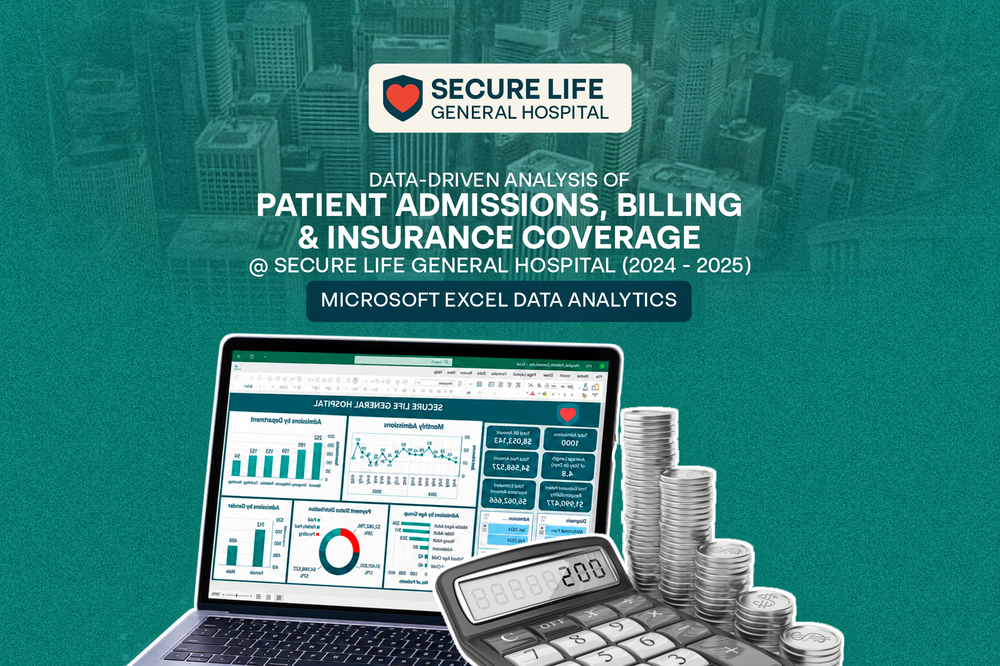
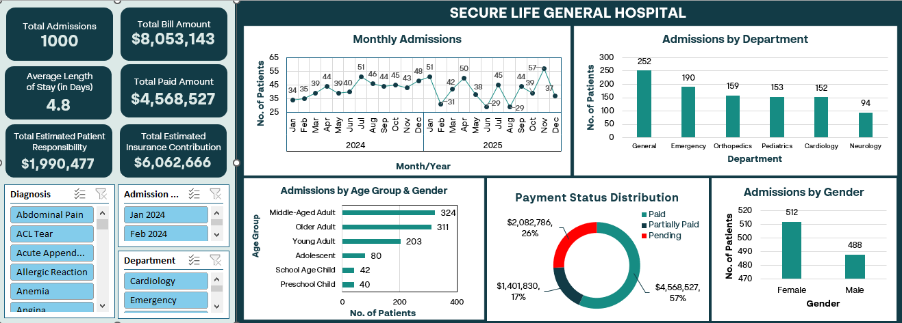

# ANALYSIS OF PATIENT ADMISSIONS, BILLING AND INSURANCE COVERAGE AT SECURE LIFE GENERAL HOSPITAL

## INTRODUCTION

The project is a mandatory exercise that the student analyst underook after three weeks of learning data analysis using Microsoft Excel as part of his training under the Data Analysis Track of FadaQa Tech Scholarship Program (FSP) 2.0. 
The healthcare sector is a data-driven sector that collects data at different levels and in different ways in order to improve the quality of healthcare services and foster a healthy nation. The hospital is an important part of the healthcare sector where the majority of healthcare services are delivered. Data such as patient admissions and financial data are collected and analyzed in order to assess operational performance, monitor finances, and inform management decision-making.
In this project, the patient admissions, billing and insurance coverage records of patients in Secure Life General Hospital (2024 – 2025) will be analyzed in order to uncover useful insights embedded in it. Find the dataset [here](https://docs.google.com/spreadsheets/d/1IdijqRZ2eYyvk2mgYRJeWwJc-bUUZA5R/edit?usp=drivesdk&ouid=107261092631480330535&rtpof=true&sd=true)

## ABOUT THE DATASET

The Secure Life General Hospital Dataset (2024 – 2025) was given to be analyzed by the student to ensure the student apply what he had learnt on the use of Microsoft Excel for data analysis. The dataset contains structured information about patients’ admission and insurance data. 

## PROBLEM STATEMENT

The management of a Secure Life General Hospital has observed a change in patient admissions, outstanding medical bills, and variations in insurance coverage across its departments. The hospital wants to use patient admission, billing and insurance data to understand its operational performance, monitor payments and improve management decision-making. However, the hospital currently lacks a consolidated report that provides a clear picture of its operational and financial performance.

## DATA PREPARATION AND ANALYSIS

### Data Inspection

The dataset was inspected for missing values and duplicates and none was found.

### Important Assumptions Made

- The student analyst assumed that since the data dictionary defined Insurance Coverage (%) as “the percentage of the total bill covered by the patient’s health insurance”, it is necessary to add two columns to calculate the Estimated Insurance Contribution i.e. the estimated amount of a patient’s total bill covered by their insurance and the Estimated Patient Responsibility i.e. the estimated amount of a patient’s total bill that is to be paid by them.
- In order to avoid confusion, the Total Paid Amount calculated includes only the sum of the amounts paid by patients whose payment status is Paid, since the dataset did not capture the amount paid by each patient whose payment status is Partially Paid.
  
## Additional Columns Created

- **Length of Stay**: to determine the number of days a patient spent in the hospital. It was gotten by calculating the difference between the Admission Date and Discharge Date.
- **Age Group**: this column categorizes the patients into different age groups as follows: <1 (Infant), <=4 (Preschool Child), <=9 (School Age Child), <=19 (Adolescent), <=39 (Young Adult), <=59 (Middle-Aged Adult), and >=60 (Older Adult).
- **Admission Month**: this column displays the month and year a patient was admitted.
- **Estimated Insurance Contribution**: the estimated amount of a patient’s total bill covered by their insurance.
- **Estimated Patient Responsibility**: the estimated amount of a patient’s total bill that is to be paid by them.
  
## DASHBOARD VISUALIZATION

Microsoft Excel was used to design and develop this interactive dashboard – including its Key Performance Indicators (KPIs), charts, PivotTables, and slicers – for analyzing trends in patient admissions, billing and insurance coverage in the dataset.

## ANALYTICAL INSIGHTS

- **Total Patient Visits**: 1,000 visits within the timeframe
- **Average Monthly Admissions**: 42.3 in 2024 and 41 in 2025.
- **Department with Highest Admissions**: General Department, 252 admissions
- **Department with Lowest Admissions**: Neurology Department, 94 admissions
  The General Department having the highest monthly admissions may be due to the general nature of the disease conditions treated there while the Neurology Department having the least number of admissions may be due to the lower prevalence of neurological diseases compared to other disease conditions.
- **Total Bill Amount**: $8,053,143
- **Department with the highest total bills**: Orthopedics Department, $2,553,862
- **Department with the lowest total bills**: Pediatrics, $572,988
- **Average Length of Stay**: 4.8 days
- **Department with highest average length of stay**: Orthopedics, 8.4 days
- **Department with lowest average length of stay**: Emergency, 2 days
- **Payment Status Distribution**: Paid - 57% ($4,568,527); Partially Paid - 17% ($1,401,380), and Pending - 26% ($2,082,786)
- **Total Bill Amount**: $8,053,143
- **Total Outstanding Bills Amount**: cannot be determine because the amount paid by each patient designated “Partially Paid” was not captured in the data set.
- **Average Insurance Coverage**: 75%
  Insurance coverage varied very slightly across departments, with Cardiology and Emergency recording the joint highest average insurance coverage of 76%; 75% for Neurology, and 74% each for General, Orthopedics, and Pediatrics departments. This might suggest that insurance schemes are accessible to a majority of the patients irrespective of the department. In relation to diagnoses, average insurance coverage is highest for Coronary Artery Disease (83%) and lowest for Asthma (62%). There is no evidence to suggest that higher insurance coverage promotes higher admissions and vice-versa.
- **Age group with the highest admissions**: Middle-aged adults (40-59 years) accounted for the highest proportion of hospital visits (324) within the period under review.
- **How admissions and billing amounts change over time**: November 2025 had the highest admissions (57), while the lowest admissions (29) were recorded in June and August 2025. November 2025 had the highest monthly billing amount ($510,413) while the lowest billing amount ($191,472) was recorded in June 2025. From the dataset, it is apparent that as monthly admissions increase or decrease, billing amount increases or decreases alongside it.
- **Payment Status Distribution**: Pending– 257; Partially Paid – 179; Paid– 564
- **Average bill amount under each category**: Pending – $8,104; Partially Paid – $7,831, and Paid – $8,100
- **Average insurance coverage for each payment status**: Pending –  72%; Partially Paid – 66%; and Paid – 79%. 
There seem to be a relationship between insurance coverage, bill amount and payment status, as patients with “pending” status have the highest average bill amount and a lower average insurance coverage than patients with “Paid” status. 

## AREAS REQUIRING MANAGEMENT ATTENTION

- The unpredictable nature of the monthly admissions recorded in 2025 calls for attention. The admissions were constantly fluctuating, with occasional significant spikes and declines, with an average monthly difference of 12.5 days recorded; compared to 2024 which recorded some level of stability in monthly admissions and an average monthly difference of 3.5 days. Management has to look into and investigate these fluctuations and factors that might be driving them.
- The designation of some patients as “Partially Paid” without records of the amount they have paid makes it impossible for the analyst to determine the amount of outstanding bills. It is recommended that subsequently the management should ensure to record the partial payments made by such patients in order to avoid disputes with patients and for reference purposes. And perhaps the most important reason is that the hospital can know her true financial state at any given time.

## RECOMMENDATIONS

The following highlight areas where the dataset could be expanded to generate deeper insights. 
- **Include Columns to Calculate Estimated Insurance Contribution, and Estimated Patient Responsibility**: two columns should be added to the dataset to calculate the amount of a patient’s total bill amount to be paid by insurance and the estimated amount to be paid by the patient (for patients with insurance coverage).
- **Include a Column for Partial Payments**: a column should be added to capture and record the amount paid by patients who made part payments.
- **Include a Column for Insurance Contribution Payment Status**: this will help to ascertain whether the estimated insurance contribution has been paid by the insurer or not.

## CONCLUSION

The analysis of patients, billing and insurance coverage data of Secure Life General Hospital provided the hospital’s management with useful insights that will inform decision-making, answer existing questions, and help improve healthcare service delivery in the hospital. Most importantly, this project has helped the student to appreciate and practice all he has learnt in the past few weeks on using Microsoft Excel for data analysis.

